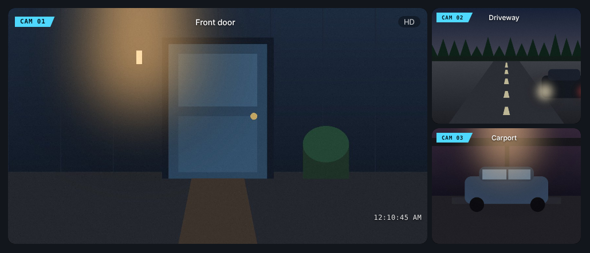
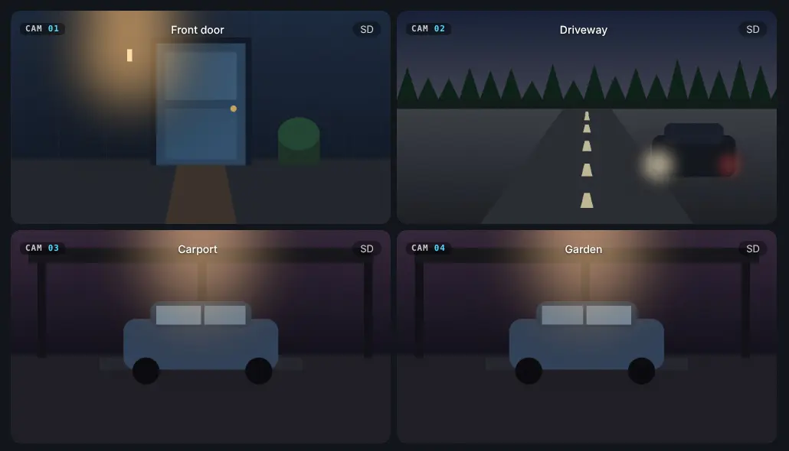
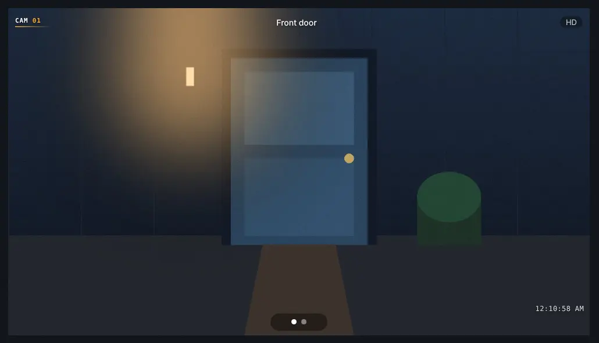
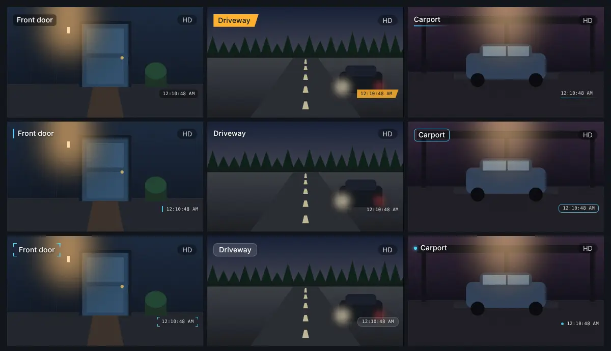
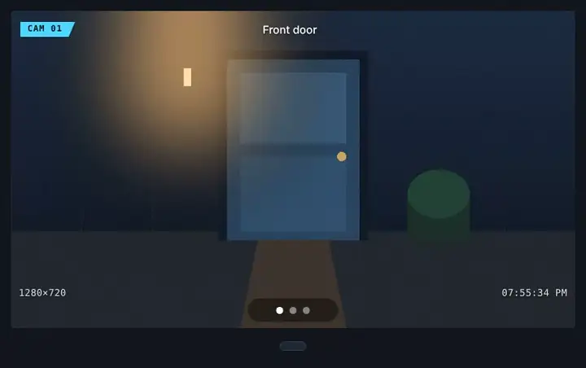
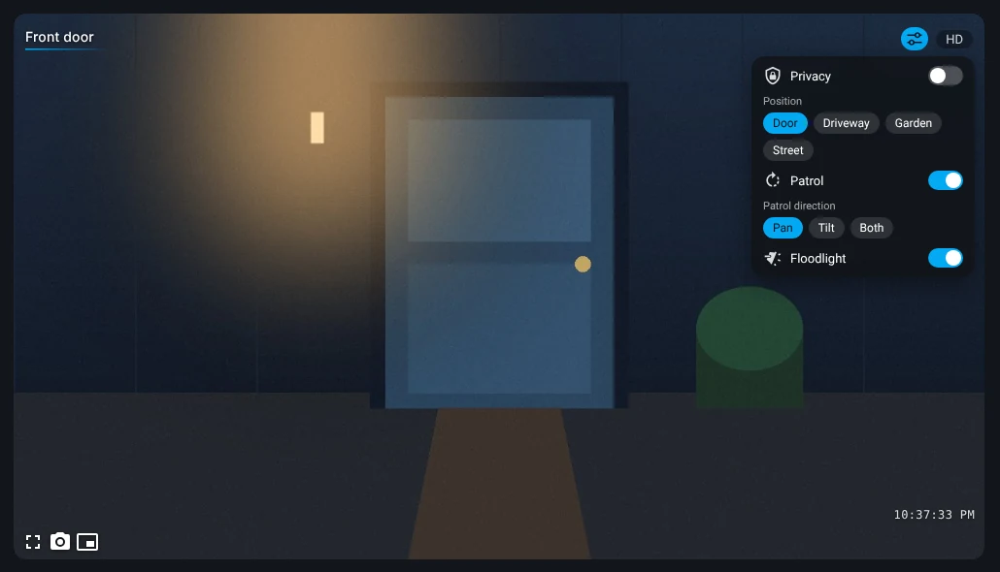
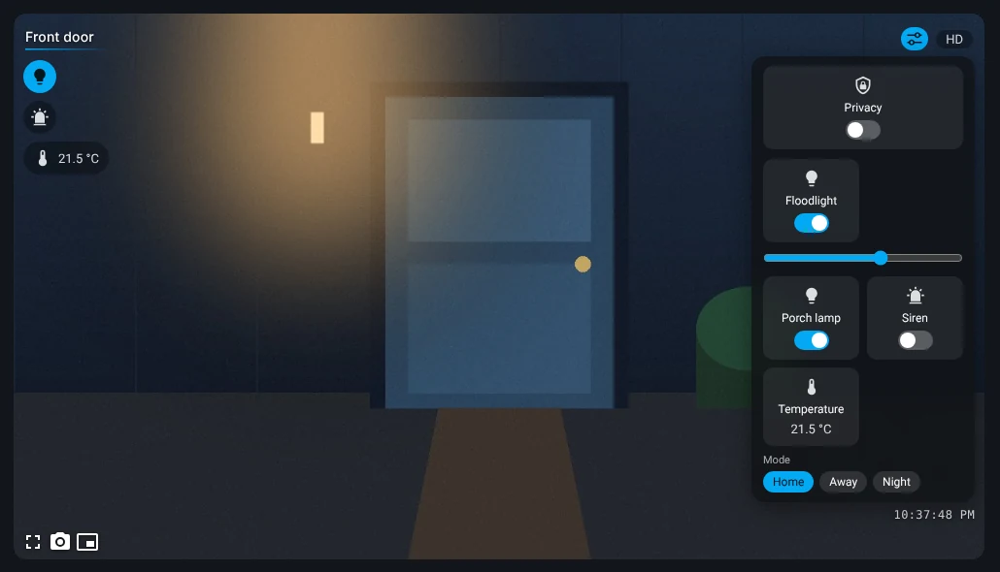
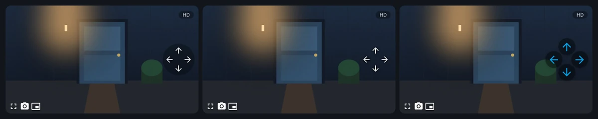

# Panoptes Card

A Home Assistant card for go2rtc camera streams. HD/SD switching, PTZ, a control panel you build yourself, digital zoom, several cameras in one card and a visual editor. It is a replacement for `custom:webrtc-camera`.



- One or many cameras in one card: a large main camera with a strip of thumbnails, a grid, or one camera at a time.
- HD on the main camera and in fullscreen, SD on thumbnails and in the grid.
- Camera switching with 16 effects (plus random). The old picture stays until the new camera plays.
- Fullscreen for the whole card, with camera switching by arrows, thumbnails, swipe or arrow keys.
- A control panel per camera that you build yourself: switches, lights, selects, buttons, numbers and sensors, in the panel or directly on the picture.
- PTZ with arrows you can style (look, size, color and placement), and a privacy mode with animated covers.
- Digital zoom with wheel, double click, drag and pinch.
- Picture fit (contain, fill or cover) for the card, for each camera and for fullscreen, also separately for phones and tablets.
- Startup animation, accent color, a camera label in nine styles, title and technical readout.
- A visual editor in English and Danish, following the Home Assistant language.
- The old `webrtc-camera` format (`streams:` and `ptz:`) still works, so you can often change only the `type:`.

## Previews

| | |
|---|---|
|  |  |
| Grid | Single camera with a camera label |

The pictures use made-up scenes instead of real camera feeds.

**Camera label styles**



## Requirements

- The **WebRTC Camera** integration ([`AlexxIT/WebRTC`](https://github.com/AlexxIT/WebRTC)) must be installed and set up in Home Assistant. Panoptes Card gets its streams through the integration's endpoint, so it also works from outside your home network (for example over Tailscale). Without the integration the card shows "Could not connect".
- go2rtc with your streams (the same stream names you use today, for example `front_door_hd`).

## Installation

### With the Marketplace (Home Assistant 2026.11 or later)

[](https://my.home-assistant.io/redirect/hacs_repository/?owner=oreskov&repository=panoptes-card&category=plugin)

Or do it by hand:

1. Open **Settings → Marketplace**.
2. Choose **Add from link** and enter `https://github.com/oreskov/panoptes-card`. Adding a repository this way requires signing in to GitHub with a device code. It only reads public information.
3. Find **Panoptes Card** and install it.
4. Reload the page with the cache cleared (Ctrl+F5). In the mobile app: Settings → Companion app → Clear frontend cache.

### With HACS (older Home Assistant versions)

1. Open HACS, open the menu (⋮) and choose **Custom repositories**.
2. Add `https://github.com/oreskov/panoptes-card` with the category **Dashboard**.
3. Download **Panoptes Card** and reload the page with the cache cleared.

Both place the file in `/config/www/community/panoptes-card/` and register the resource themselves. If you manage dashboard resources in YAML, they cannot add it for you. The install dialog then shows what to add manually, or follow the manual steps below.

### Manually

1. Copy `panoptes-card.js` to `/config/www/` (or a folder under it).
2. Go to **Settings → Dashboards → ⋮ (top right) → Resources → Add resource**
   - URL: `/local/panoptes-card.js`
   - Type: **JavaScript module**

   If the menu item is missing, turn on *Advanced mode* in your user profile.
3. Reload the page with the cache cleared.

When you update the file later, change the resource URL to for example `/local/panoptes-card.js?v=2`, so the browser fetches the new version.

### Add the card

Edit the dashboard, choose **Add card**, and search for **Panoptes**. Or add a manual card with YAML:

```yaml
type: custom:panoptes-card
cameras:
  - name: Front door
    streams:
      - url: front_door_hd
        name: HD
      - url: front_door_sd
        name: SD
```

Use the stream names from your own go2rtc. More examples are in [`example.yaml`](example.yaml).

### Coming from `webrtc-camera`

Change only the type. The old format keeps working:

```yaml
type: custom:panoptes-card
streams:
  - url: front_door_hd
    name: HD
    mode: webrtc
  - url: front_door_sd
    name: SD
    mode: webrtc
```

If you open such a card in the visual editor and change something, it is saved in the newer `cameras:` format. The card itself works unchanged until you change something.

---

## Several cameras

- **`layout`:** `auto` (default: focus + strip with several cameras, single with one), `focus` (one large camera and the others as thumbnails), `grid` (all the same size) or `single` (only the first camera).
- **Focus + strip:** click a thumbnail to make it the main camera. The cameras slide into place (turn off with `animations: false`). The strip sits to the right or at the bottom (`strip: auto` chooses from the card width and the number of thumbnails).
- **Grid:** `grid_columns` 1 to 4 (automatic from the width). Clicking a tile opens it in fullscreen.
- **HD only where it matters (`auto_quality`, on by default):** the main camera, single and fullscreen use the first stream (HD). Thumbnails and grid use the last (SD). Write HD first and SD last. The quality button on the main camera can override this.
- Thumbnails and grid tiles show only the picture and the title. Buttons, PTZ and zoom are on the main camera and in fullscreen.
- Every camera has its own `ptz:`. A `ptz:` at the top of the card applies to the first camera, so old setups keep working.

## Switching camera and quality



When you switch camera, the old picture stays frozen until the new camera plays, and then the card changes with the chosen effect. The same goes for switching between HD and SD: the picture stays frozen until the new quality plays and then fades over, while the quality button pulses briefly. The speed follows `intro_speed`.

The effect is chosen under **Layout** and applies to both Single and Focus + strip. In Single, Slide pushes the picture out to the side. In Focus + strip, Slide makes the tiles glide into place, while the other effects swap the tiles at once and let the new main camera replace the old one with the effect. `animations: false` turns off all switch effects in Focus + strip.

Values for `switch_effect`:

| Value | Effect |
|---|---|
| `soft` | Soft transition |
| `slide` | Slide |
| `zoom` | Zoom |
| `flip` | Flip |
| `pixel` | Pixel |
| `cube` | Cube (3D): both cameras on the sides of a rotating cube |
| `push` | Push: the new camera slides in over the old one |
| `spin` | Spin and zoom |
| `roll` | Roll: the old camera rolls up |
| `blur` | Blur |
| `glitch` | Glitch with color shift and disturbed stripes |
| `mosaic` | Mosaic: squares flip in random order |
| `noise` | Noise: a short burst of TV noise with scanlines |
| `wash` | Color wipe: bands in the accent color sweep across (color) |
| `tint` | Color filter: the picture is tinted in the accent color and fades over (color) |
| `ripple` | Ripple: water waves with colored rings (color) |
| `random` | Random: a new effect at every switch |
| `none` | No effect |

The color effects follow the accent color (`accent_color`). The effects use still frames of the cameras, so the live video is never rotated or distorted. If a new frame cannot be taken, Soft is used.

## Carousel

With `carousel: true` the card switches between the cameras by itself. It pauses while you use the card (hover, touch, zoom or an open panel) and starts again after a few seconds without activity. It also pauses when the tab is hidden or the card is out of view. Cameras with privacy turned on are skipped. In the grid layout nothing happens. Turn it on under **Layout** in the editor.

The pause button (`carousel_pause`, on by default) lets you hold the carousel yourself. It sits in the top right, in the same row as the panel button and the quality button (HD/SD), furthest to the left. Press it again to continue. It is also available in fullscreen, and the pause is not saved when the page reloads.

## Fullscreen

Fullscreen covers the whole card, so you can switch camera without leaving fullscreen. It works in all layouts, including Grid and Focus + strip, and opens on the camera you pressed. Under **Layout** you choose how to switch (several can be combined):

- **Arrows and dots:** a pill at the bottom center.
- **Thumbnails along the edge:** small pictures with names. The pictures refresh every 4 seconds, and cameras that are not running right now show their latest picture.
- **Swipe** sideways on touch (not while zoomed in).
- **Arrow keys** left and right on a computer.

Switching uses the chosen switch effect. The carousel continues in fullscreen by default (`fullscreen_carousel`) and pauses as usual on zoom or an open panel. In the multi-camera layouts you can also close the connection to the cameras you cannot see while fullscreen is open (`fullscreen_pause_others`, off by default). That saves network and power, and the setting has no effect while the carousel runs in fullscreen. Not tested on iPhone and iPad: where the browser does not allow fullscreen for the whole card, only the video's own fullscreen is used, and switching camera in fullscreen is then not available.

## Control panel and privacy

Every camera can get a `control:` section with entities. A small button at the top right, next to HD/SD, opens a panel over the picture (on narrow cards it opens from the bottom). The panel is shown only on the large camera and only with the entities you chose. Choose the entities in the editor under **Cameras**, and panel and cover under **Control**. If you choose one entity, the editor suggests the others from the name.



```yaml
cameras:
  - name: Driveway
    streams: [{name: HD, url: driveway_hd}]
    control:
      privacy: switch.camera_driveway_privacy
      preset: select.camera_driveway_move_to_preset
      patrol: switch.camera_driveway_preset_patrol_mode
      patrol_mode: select.camera_driveway_patrol_mode
      light: light.camera_driveway_floodlight_timed
```

- **Privacy:** a switch. When it is on, the other controls in the panel are hidden, the PTZ ring is hidden, and the picture is covered. The cover is chosen with `privacy_cover`: `black` (default), `blur`, `network`, `stream`, `radar`, `cams`, `clock` or `none`. The animations use the startup color and only run while the camera is in view. Small cameras (thumbnails and grid) animate too, unless `privacy_cover_small: false`.
- **Presets:** optional. `preset_style`: `auto` (buttons up to six, then a dropdown), `buttons` or `dropdown`.
- **Patrol:** a switch and a direction (Horizontal/Vertical). While the patrol runs, the PTZ ring is hidden.
- **Light:** turns the floodlight on and off.
- `control_panel: false` hides the panel button completely (the cover still works).

### Your own panel elements

By default the panel shows the five controls above. With `panel_mode` on the camera you can build the panel yourself, per camera. In the picture below the panel is a grid, and three elements sit directly on the picture (the lamp and the siren as icons, the temperature with its value):



The options:

- `panel_mode: default` is the standard panel from `control:` (nothing to set).
- `panel_mode: extra` is the standard panel plus your own elements.
- `panel_mode: custom` is only your own elements.

The elements are listed in `panel_items`. In the editor, "Insert standard elements" recreates the standard panel as editable rows, and the copy button copies the list to other cameras.

```yaml
cameras:
  - name: Driveway
    streams: [{name: HD, url: driveway_hd}]
    panel_mode: custom
    panel_items:
      - type: privacy                       # the privacy switch (uses control.privacy)
      - entity: light.driveway_floodlight   # a switch, light, select, button, number ...
        name: Floodlight
        icon: mdi:lightbulb
        display: light-slider               # how it looks (see below)
        color_on: "#ffb000"
        on_picture: left                    # also directly on the picture
        pic_show: name_icon_value           # what the picture shows (see below)
      - entity: select.driveway_mode
        display: chips
        hide_ptz: true                      # hide the PTZ ring while this is on
```

- **Entities:** `switch`, `input_boolean`, `light`, `fan` (toggle), `select`, `input_select` (choose an option), `button`, `input_button` (press), `script`, `scene` (run), `number`, `input_number` (slider) and read-only `sensor`, `binary_sensor`.
- **display:** `auto` (the card chooses), `toggle`, `light-slider`, `select`, `chips`, `dropdown`, `button`, `slider` or `value`.
- **Item settings:** `name`, `icon`, `color` and `color_on` (a color), `in_panel` (default `true`), `on_picture` (`none`, `left` or `right`), `pic_show` and `hide_ptz`.
- **pic_show:** what an element shows on the picture. Default: only the icon on switches and buttons, icon and value on read-outs. Other choices: `icon`, `value` (status only), `icon_value`, `name_icon_value` and `name`. Buttons have no status, so they keep their icon.
- **Status text:** the status is shown in Home Assistant's own wording and language (for example "Off" or "Slukket").
- **Copy a whole panel:** under the element list, "Copy panel" stores the camera's panel and "Paste panel" puts it on another camera, also on another dashboard. If pasting does not work in your browser, a text box appears where you paste the copied text. A camera with the standard panel has nothing to copy until you press "Insert standard elements". The entity names follow along, so change them on the new camera.
- **On the picture:** elements with `on_picture` sit in two columns under the title row. If there is no room, they move into the panel. They keep clear of the PTZ arrows, the side arrows and the panel. Select and slider elements on the picture are read-only.
- **Services:** the card only calls a few services: switch on/off, select option, button press, script and scene on, number set value and light brightness.

### Panel look

These settings apply to the whole card (the Panel tab in the editor).

| Setting | Default | What it does |
|---|---|---|
| `panel_open` | `auto` | `auto` (under the button on wide cards, at the bottom on narrow ones), `under_button` or `bottom`. |
| `panel_layout` | `list` | `list` (one row per element) or `grid` (small tiles). |
| `panel_bg` | `glass` | `glass`, `solid` or `clear`. |
| `panel_opacity` | `0.82` | How see-through the glass is (0.3 to 1). |
| `panel_radius` | `14` | Corner radius in px (0 to 32). |
| `panel_width` | `230` | Width in px when the panel opens under the button (160 to 360). |
| `panel_color_on` | `accent` | Color for "on" in the panel and on the picture: `accent` or `custom` (see `panel_color_on_custom`). An element's own color wins. |
| `panel_color_on_custom` | | Your own color, for example `"#ff00ff"`. |
| `privacy_hides_others` | `true` | While privacy is on, hide all other elements. Set `false` to keep them visible. |

## Startup animation

When the card loads, a short startup plays. The picture appears only when the stream is actually running, and with several cameras they start one after another. Choose it in the editor under **Startup** (everything can be turned off):

- **Focus in** (default): the picture goes from blurred to sharp with a short light change. No text.
- **Boot text:** small lines of text with the camera name, stream and connection type, for example `PANOPTES // FRONT DOOR`, `CONNECTING front_door_hd ...`, `RTC OK`. Then the picture blinks in.
- **Frame draw:** a thin line draws itself around the edge of the camera and fades out while the picture appears.
- **Light bar:** a glowing line slides down over the picture and reveals it.
- **Circle:** the picture opens like an iris from the center.
- **TV on:** a glowing line in the middle expands like on an old tube TV.
- **Blinds:** horizontal blinds open and show the picture.
- **None:** no startup.

The color is chosen between the Home Assistant primary color (the default), ice blue, white, green, amber, red, violet or your own color (for example `#4fd8ff`). The speed is fast, normal or slow. The startup is not played if the operating system is set to reduced motion. If the camera has no connection, the picture (and the error message) is shown after at most 9 seconds.

---

## Settings

Everything can be set in the visual editor. Default values are not written to the YAML.

### Cameras and layout

| Setting | Default | What it does |
|---|---|---|
| `cameras` | | List of cameras. Each camera has `name`, `streams` and optionally `ptz` and `control`. An optional `label` is your own text for the camera label (max. 24 characters). Optional `video_fit` and `video_fit_fs` override the card's picture fit for that camera only (see below). |
| `layout` | `auto` | `auto`, `focus`, `grid` or `single`. See "Several cameras". |
| `switch_effect` | `soft` in Single, `slide` in Focus + strip | Effect when switching camera. See the list under "Switching camera and quality". |
| `camera_nav` | `true` | With `layout: single` and several cameras: arrows at the sides and dots at the bottom to switch camera. On touch you can also swipe. |
| `nav_position` | `bottom` | Placement of the camera switch: `bottom` (a pill with dots at the bottom) or `sides` (arrows at the sides). |
| `carousel` | `false` | Carousel: switches the shown camera automatically (layout Single, and the main camera in Focus + strip). |
| `carousel_interval` | `10` | Seconds between switches (3 to 600). The editor offers 5, 10, 15, 30 and 60. |
| `carousel_bar` | `true` | A thin line at the bottom that fills up toward the next switch. |
| `carousel_pause` | `true` | Pause button for the carousel (next to the panel button), so you can hold it yourself. Only shown when the carousel is on. |
| `fullscreen_nav` | `true` | Switch camera in fullscreen. When off, fullscreen shows only the camera you opened. |
| `fullscreen_nav_modes` | `[arrows, swipe, keys]` | How to switch in fullscreen: `arrows` (arrows and dots), `thumbs` (thumbnails), `swipe`, `keys` (arrow keys). |
| `fullscreen_carousel` | `true` | The carousel also switches camera in fullscreen. |
| `strip` | `auto` | Where the thumbnails sit in the focus layout: `auto`, `right` or `bottom`. |
| `grid_columns` | automatic | Columns in the grid (1 to 4). |
| `gap` | `8` | Space between the cameras in pixels (0 to 40). |
| `auto_quality` | `true` | HD only on the large camera, SD in thumbnails and grid. |
| `animations` | `true` | Gliding change when another camera becomes the main camera. |
| `aspect_ratio` | `16/9` | The shape of the picture box on the card: `16/9`, `4/3`, `21/9`, `3/2`, `1/1`, `9/16`, or your own such as `16/10` (choose **Custom** in the editor). The camera's own picture is not changed. |
| `video_fit` | `contain` | How the picture fills its box on the card (large camera, single view and grid tiles): `contain` shows the whole picture, with black bars if the shapes differ; `fill` stretches the picture to fill the box (it is distorted if the shapes differ); `cover` fills the box without distortion but cuts off the edges. Thumbnails always use `cover`. Can be set per camera, see below. |
| `video_fit_fs` | `contain` | The same choices, for fullscreen only. `fill` and `cover` make the picture fill the whole screen. |
| `video_fit_fs_touch` | `follow` | Fullscreen on phones and tablets (touch screens) only, for example `cover` to always fill the screen there while a PC keeps `video_fit_fs`. `follow` means the same as `video_fit_fs`. A camera's own `video_fit_fs` still wins over this card setting. Per camera, `video_fit_fs_touch` overrides everything else on touch screens. |
| `corner_radius` | the Home Assistant default | Corner radius in pixels (0 to 32) on the card and the camera frames. |

#### Picture fit per camera

Every camera can have its own picture fit (in the editor: open the camera, **Picture fit**). The first choice is **Follow the card**.

```yaml
type: custom:panoptes-card
aspect_ratio: 16/9
video_fit: contain          # the card default
video_fit_fs: cover         # fullscreen fills the screen
cameras:
  - name: Robot
    video_fit: fill         # this 4:3 camera fills the 16:9 box
    streams:
      - {url: robot, name: HD}
  - name: Front door
    streams:
      - {url: front_door_hd, name: HD}
```

### Playback

| Setting | Default | What it does |
|---|---|---|
| `streams` | | (Old format) List directly on the card. Each stream has `url` (go2rtc name or URL), `name`, `mode`, `media` and optionally `entity`. |
| `mode` | automatic | How the stream is fetched: leave empty for automatic (tries WebRTC, then MSE, HLS and MJPEG), or choose `webrtc`, `mse`, `hls` or `mjpeg`. Can also be set on a single stream. Under **Advanced** in the editor. |
| `muted` | `true` | Sound off by default. |
| `ui` | `own` | Buttons on the picture: `own` (the card's own buttons: fullscreen, screenshot, picture-in-picture, play, sound; the same on every device), `browser` (the browser's own player controls, only on the large camera, never on small tiles; they look different in every browser) or `none` (a clean picture, the browser's picture-in-picture button is hidden too). |
| `pip` | `auto` | Only with `ui: own`. Picture-in-picture: `auto` (the card's button only on a computer), `always`, `never` (hides only the card's own button), `own` (keeps the card's own button and hides the browser's, for example Firefox's small PiP button) or `off` (turns PiP off completely on the video). |
| `digital_zoom` | `true` | Zoom and pan with wheel, double click, drag and pinch. |
| `double_tap_zoom` | `true` | Double click (computer) and double tap (touch) zoom in and out. Can be turned off without losing wheel, drag and pinch. |
| `pause_offscreen` | `true` | Stops the stream when the card is out of view or the tab is hidden. Turned off, it keeps running out of view but still stops in a hidden tab. |
| `fullscreen_pause_others` | `false` | Multi-camera layouts: in fullscreen the cameras you cannot see close their connection and reconnect when they are needed. Saves network and processing power, but switching camera can take a moment longer, and the thumbnails in the bar stay still. Does not work together with the carousel in fullscreen. |
| `intersection` | `0.5` | How much of the card must be visible. `0` turns the pause off. |
| `background` | `false` | The stream never stops, not even out of view, in a hidden tab or hidden in fullscreen. Overrides `pause_offscreen` and `fullscreen_pause_others`. Uses more network and power. Picture-in-picture turns it on by itself while it is open. |
| `poster` | | go2rtc stream name or image URL shown while the stream loads. |
| `server` | | Another go2rtc address (rarely needed). |

### Look

| Setting | Default | What it does |
|---|---|---|
| `accent_color` | `primary` | The accent color, used everywhere: startup, color effects, active buttons, markers and the number in the camera label. `primary` (the Home Assistant primary color, so the card follows your theme), `ice` (ice blue), `white`, `green`, `amber`, `red`, `violet` or `custom`. |
| `accent_color_custom` | | Your own color, used when `accent_color: custom`. Chosen with the color picker in the editor and saved as `#rrggbb` (YAML can also have `rgb(79 216 255)`). |
| `intro` | `focus` | Startup: `focus`, `boot`, `frame`, `scan`, `iris`, `tv`, `blinds` or `none`. |
| `intro_speed` | `normal` | `fast`, `normal` or `slow`. |
| `title_position` | `top-center` | Placement of the title: `top-left`, `top-center`, `top-right`, `bottom-center` or `hidden`. |
| `title_offset` | `14` | Distance of the title from the edge in pixels (0 to 100). |
| `readout` | | Technical readout at the bottom of the large camera. A list with `connection`, `resolution`, `fps`, `bitrate`, `clock`. The default is `connection`, `resolution`, `clock`. `readout: []` hides it. |
| `show_status` | `false` | Shows the connection type (RTC, MSE and so on) next to the name. |
| `still_size` | `medium` | Size of the still frames used by switch effects: `medium` (1280 px wide), `small` (640 px, lightest) or `full` (the video's full resolution). Under **Advanced** in the editor. |

### Camera label

A small label next to the title, by default `CAM 01` (the camera's place in the list). Off by default.

| Setting | Default | What it does |
|---|---|---|
| `cam_label` | `false` | Shows the label. |
| `cam_label_style` | `pill` | `pill` (dark rounded background), `tab` (filled tab in the accent color), `line` (text with a thin accent line below), `bar` (a short accent stroke in front), `text` (text only), `outline` (thin accent frame), `corners` (small corner brackets), `glass` (translucent and blurred) or `dot` (accent dot in front of the text). |
| `cam_label_color` | `auto` | Text color: `auto` (the style chooses), `white`, `accent` or `custom` (see `cam_label_color_custom`). With `accent` or `custom` the filled tab gets a dark background. |
| `cam_label_color_custom` | | Your own color (for example `"#ffb000"`) when `cam_label_color: custom`. |
| `cam_label_text` | `number` | What the label shows: `number` (CAM number) or `name` (the camera's name, so the label can replace the title; hide the title with `title_position: hidden`). A `label` on the camera always wins. |
| `cam_label_pos` | `top-left` | Placement on the large camera and in Single: `top-left`, `top-center`, `top-right`, `bottom-left`, `bottom-center`, `bottom-right` or `hidden`. At the top the label sits next to the title, at the bottom above the technical readout (bottom center, like the title). |
| `cam_label_pos_small` | `top-left` | The same for small tiles (strip and grid). |
| `cam_label_pos_fs` | `top-left` | The same for fullscreen. |
| `cam_label_offset` | `14` | Distance from the top or bottom in px (0 to 100). Applies at top and bottom center, like `title_offset`. |
| `cam_label_side` | `12` | Distance from the left or right edge in px (0 to 100) when the label is in a corner. |
| `cam_label_readout` | `false` | The technical readout at the bottom gets the same style and color as the label. |
| `cam_label_readout_color` | `own` | `own` (the readout uses the style's own colors) or `label` (the same text color and background as the label). Only relevant together with `cam_label_color`. |

`visibility` and `grid_options` (for example `columns: full`) are handled by Home Assistant itself and work as before, also with the privacy switch.

### Control panel

| Setting | Default | What it does |
|---|---|---|
| `control_panel` | `true` | Panel button for camera control (see "Control panel and privacy"). |
| `preset_style` | `auto` | `auto`, `buttons` or `dropdown`. |
| `panel_*` and `privacy_hides_others` | | The look of the panel, see "Panel look". |
| `privacy_cover` | `black` | Cover while privacy is on: `black`, `blur`, `network`, `stream`, `radar`, `cams`, `clock`, `none`. |
| `privacy_cover_small` | `true` | Animation in the privacy cover also on thumbnails and grid tiles. |
| `privacy_cover_quality` | `normal` | Sharpness of the animated covers: `low` (saves memory), `normal` or `high` (follows the screen). Higher is sharper on sharp screens but uses more memory while privacy is on. |

## PTZ

PTZ is shown only if you set it up. The card calls a Home Assistant service when you press the arrows. For Tapo cameras these are the button entities:

```yaml
ptz:
  service: button.press
  data_left:
    entity_id: button.camera_driveway_move_left
  data_right:
    entity_id: button.camera_driveway_move_right
  data_up:
    entity_id: button.camera_driveway_move_up
  data_down:
    entity_id: button.camera_driveway_move_down
```

In the editor you choose one button, and the card suggests the other three if they are named `..._move_left/right/up/down`. `ptz.enabled: false` turns PTZ off without deleting the setup. `ptz.opacity` (0 to 1) controls how visible the arrows are.

### PTZ look

The arrows can be styled per camera, inside the camera's `ptz:`. All of it is also in the editor.



| Setting | Default | Description |
|---|---|---|
| `style` | `ring` | `ring` (round plate), `cross` (only the arrows) or `buttons` (each arrow in its own round button). |
| `size` | `medium` | `small`, `medium` or `large`. |
| `pos` | `right` | Where the arrows sit: `top-left`, `top`, `top-right`, `left`, `center`, `right` (middle right), `bottom-left`, `bottom`, `bottom-right`. Top starts below the name row, bottom sits above the button row. |
| `color` | `white` | `white`, `accent` (the theme color) or `custom` (then set `color_custom`, for example `'#4fd8ff'`). |
| `opacity` | `0.4` | How visible the arrows are until you point at them (0 to 1). |

```yaml
ptz:
  service: button.press
  data_left: {entity_id: button.camera_driveway_move_left}
  data_right: {entity_id: button.camera_driveway_move_right}
  data_up: {entity_id: button.camera_driveway_move_up}
  data_down: {entity_id: button.camera_driveway_move_down}
  style: buttons
  size: large
  pos: bottom-right
  color: accent
```

Elements on the picture make room for the arrows. If they do not fit, the rest goes to the panel as before.

## Performance

A camera card runs live video, so it is worth keeping the load down. The defaults are chosen for that:

- Only the main camera and fullscreen use HD (`auto_quality`). Thumbnails and the grid use the SD stream.
- The stream stops when the card is scrolled out of view or the tab is hidden (`pause_offscreen`). In fullscreen the cameras behind the visible one keep running unless you turn on `fullscreen_pause_others`. It is off by default, because switching camera can then take a moment longer.
- Switch effects work on still frames, so the live video is never transformed. The frames are limited to 1280 px wide (`still_size`). On a weak device, use `small`, turn off `animations` or set `switch_effect: none`.
- The animated privacy covers only run while the camera is in view. `privacy_cover_small: false` keeps the small tiles still, and `privacy_cover_quality: low` uses less memory.
- The startup animation is skipped when the operating system is set to reduced motion.

If a tablet or an old phone stutters: use a grid with fewer cameras, keep the SD stream last in the list, set `switch_effect: none`, and `intro: none`.

## Known limitations

- Not yet: motion sensor highlight, automatic HD/SD pairing, microphone/talk to the camera.
- PTZ: the arrows turn the camera (directions only). Optical zoom, home position and press-and-hold are not supported. Digital zoom in the picture works separately (`digital_zoom`).
- The stream list is not fetched from go2rtc. You type the names in the editor.
- With `pip: own` in Firefox, the browser's own picture-in-picture button comes back after the first use of the card's button, until the page is reloaded.

## Troubleshooting

**"Could not connect"**
Check that the WebRTC Camera integration is installed and that the stream name exists in go2rtc.

**The card does not exist ("Custom element doesn't exist")**
The resource is not added, or the cache must be cleared (Ctrl+F5). Open F12 → Console. It should say `PANOPTES-CARD v1.1.0` when the card is loaded.

**It works at home but not from outside**
The card uses the WebRTC Camera integration's endpoint through Home Assistant. If Home Assistant itself works from outside (for example over Tailscale), the cameras do too. A direct `server:` address to go2rtc only works where that address can be reached.

**Reporting a problem, or measuring load**
Add `debug: true` to the card's YAML (there is no editor switch for it). A small box appears on the card with the version, uptime, memory use, how many streams are running and how many videos and canvases exist. Include its text if you open an issue on GitHub. Remove the line again when you are done.

**Sound or picture-in-picture does not work**
Browsers only allow sound after a tap on the page, and picture-in-picture needs a click on the button.

---

## For those who want to edit the code

The file is divided into sections with comments:

1. **PanoptesPlayer:** fetches and plays the stream (WebRTC, MSE, HLS, MJPEG).
2. **PanoptesTile and PanoptesCard:** the card itself: layouts with one or more cameras, buttons, PTZ, digital zoom, effects and fullscreen.
3. **STRINGS:** all texts in English and Danish.
4. **PanoptesCardEditor:** the form in the visual editor, built from tabs.
5. **Registration:** makes the card known to Home Assistant.

Defaults for all settings are collected in one place. Start there to add a new setting, and add it to the editor schema and to `STRINGS`.

### Translations

All texts are in the `STRINGS` object, with the keys `label.*`, `help.*` and `o.<setting>.<value>` for dropdown choices. To add a language, copy the whole `en` block, give it the language code (for example `de`), and translate the values. A missing text falls back to English. Pull requests with new languages are welcome.

---

## Release notes

**1.1.0**

*Control panel*
- Build your own panel per camera: add any switch, light, select, button, number or sensor (`panel_mode`, `panel_items`), choose how it looks, its icon and colors, and place it in the panel or directly on the picture (`on_picture`, `pic_show`).
- Elements can hide the PTZ ring (`hide_ptz`). The standard panel can be recreated as elements you can edit.
- Copy the list to other cameras, or copy and paste a whole panel with the card's own clipboard.
- The status is shown in Home Assistant's own wording and language.
- New look settings for the whole card (`panel_open`, `panel_layout`, `panel_bg`, `panel_opacity`, `panel_radius`, `panel_width`, `panel_color_on`) and `privacy_hides_others`.
- The carousel pause button now sits in the top-right row next to the panel button.

*Picture*
- Picture fit: `video_fit` and `video_fit_fs` (contain, fill or cover) on the card and in fullscreen, also per camera, so a 4:3 camera can fill a 16:9 box or the whole screen. `video_fit_fs_touch` sets the fullscreen choice for phones and tablets only.
- The aspect ratio is now a menu (with a custom option). Switch effects follow the chosen fit.
- PTZ arrows can be styled per camera: `style` (ring, cross or four buttons), `size`, `color`, `opacity` and `pos` (nine places) inside `ptz:`, also in the editor.
- During the startup animation only the animation is shown. Buttons, title, elements and PTZ fade in afterwards.

*Editor*
- The Layout and Look tabs are split into collapsible groups.
- New help texts for several settings (camera switching position, carousel interval and progress line, thumbnail strip, grid columns, smooth switching, intro speed, custom aspect ratio, digital zoom, double tap zoom, muted).

**1.0.0** First public release.

## License

MIT. See [LICENSE](LICENSE). The stream handling is adapted from `video-rtc.js` in [AlexxIT/WebRTC](https://github.com/AlexxIT/WebRTC) (MIT). See [NOTICE](NOTICE).
